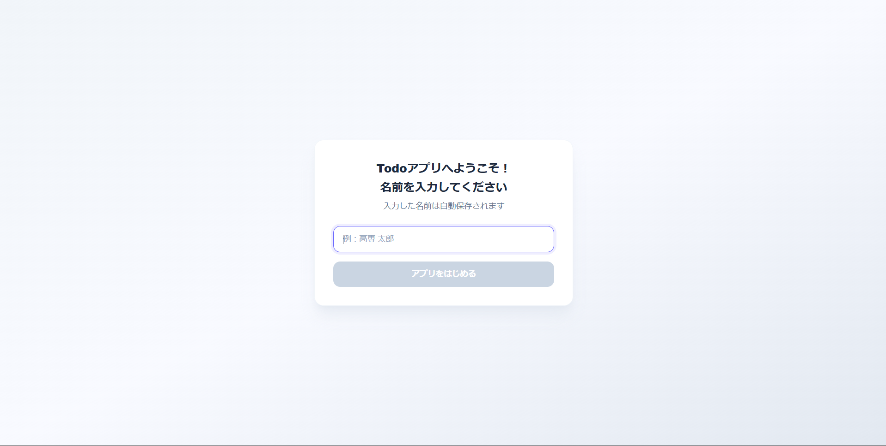
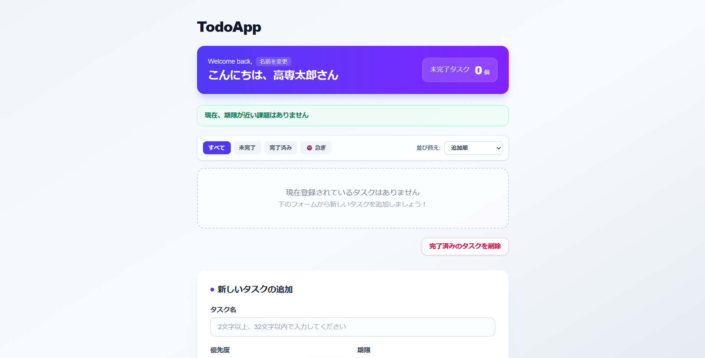
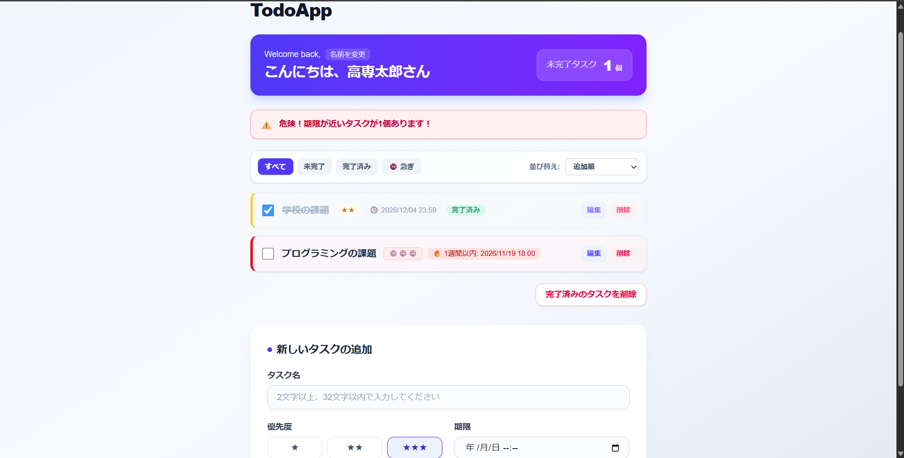
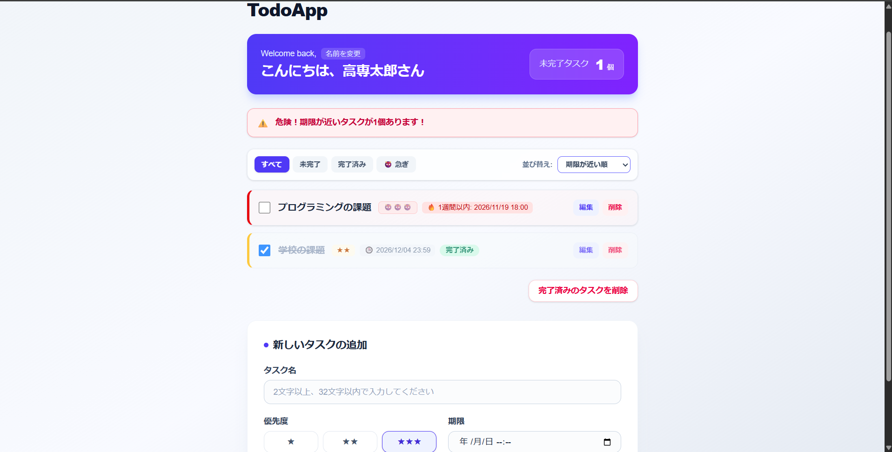

# 公開 URL

[Todoアプリ](https://random0210.github.io/react-todo-app/)

# 機能

最初にこのTodoアプリを開くと、**ユーザー名を登録する画面**が表示されます。自分の好きな名前を入力して始めることができ、入力した名前やタスクのデータはブラウザ（ローカルストレージ）に自動保存されるため、2回目以降は登録画面をスキップしてすぐに使い始められます。名前はヘッダーのボタンからいつでも変更可能です。

タスクの追加・削除はもちろん、**絞り込み（フィルター）**と**並び替え（ソート）**に対応しています。すべて・未完了・完了済みに加えて、期限が迫っているタスクだけを表示する「急ぎ」フィルターや、追加順・期限が近い順・優先度順での並び替えができます。

また、期限が近づくとタスクの重要度アイコンが自動で変化します。通常は星で表示されますが、期限まで1週間を切ると鬼に、期限を過ぎるとどくろに変わり、カードの色も警告色に変化します。さらに、画面上部のバナーでも期限が1週間以内のタスクが何個あるかを知らせてくれます。

そのほか、一度登録したタスクを後から直接書き換えられる編集機能や、完了済みのタスクをまとめて整理する一括削除機能も備えています。

# 開発背景

チュートリアルをベースに作成した際、最初はあらかじめ用意されたサンプルデータが表示される仕様でしたが、「自分専用のTodoアプリとして使えるようにしたい」と考え、最初にユーザー名を登録してローカルストレージに保存する仕組みを追加しました。

また、ただタスクを並べるだけでは「どの課題の締め切りが迫っているのか」を見落としやすいと感じたため、期限が1週間以内になるとアイコンがに変わり、期限切れになるとに変わる機能を取り入れました。文字で日付を読むだけでなく、アイコンやカードの色でパッと見て緊急度が分かるように工夫しています。

ソート機能やフィルター機能についても、課題が増えてきたときに「期限が近いもの」や「急ぎのタスク」をすぐに見つけられるように追加しました。一度登録したタスクの期限や内容を後から直したい場面が多かったため、削除して作り直さなくてもその場で修正できる編集機能も実装しています。

UI面では、単なる縦並びのリストではなくダッシュボードのように見やすく整理された画面を目指し、カード型のレイアウトや色分けを調整して視認性を高めました。

# 開発技術

フロントエンドの開発には TypeScript と React を使用し、画面のデザインやレイアウトの調整には Tailwind CSS を使用しました。

また、日時の計算やフォーマット処理には dayjs、タスクごとの固有IDの生成には uuid を取り入れ、ユーザー名やタスクデータの保存にはローカルストレージを使用しています。

# 仕様画面

### ユーザー名登録画面

### メイン画面（タスク一覧・追加）

### 期限接近・期限切れの警告表示

### フィルター・ソート・編集画面

# 開発期間

開発期間: 2026.10.23 ~ 2026.11.18 (約21時間)

# ライセンス

 [MIT License](https://opensource.org/licenses/MIT) 